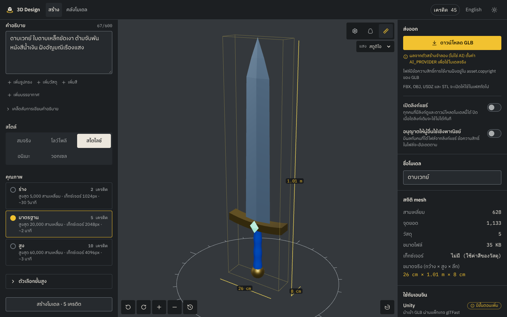

# 3D Design

เว็บแอปสร้างโมเดล 3D จากคำอธิบาย (text-to-3D) ตรวจบนโต๊ะหมุน แล้วดาวน์โหลด GLB ไปใช้ในเกมและงานออกแบบ



| เอกสาร                               | เนื้อหา                                                                               |
| ------------------------------------ | ------------------------------------------------------------------------------------- |
| [DESIGN.md](DESIGN.md)               | palette, typography, layout, wireframe, หลักการออกแบบ และสิ่งที่เปลี่ยนจากค่าเริ่มต้น |
| [docs/services.md](docs/services.md) | API key และบริการภายนอกที่ต้องใช้ พร้อมวิธีตั้งค่า                                    |
| [docs/roadmap.md](docs/roadmap.md)   | แผน phase ถัดไป (auth, ชำระเงิน, image-to-3D, rigging, gallery …)                     |
| [docs/critique.md](docs/critique.md) | ผลตรวจหลังสร้าง: responsive, keyboard, reduced motion, contrast, บั๊กที่เจอและแก้     |
| [docs/legal.md](docs/legal.md)       | สิทธิ์ในโมเดล, การกรองเนื้อหา, สิ่งที่ต้องให้ทนายตรวจ                                 |

## สถานะ MVP

| ทำแล้ว            | รายละเอียด                                                                                                 |
| ----------------- | ---------------------------------------------------------------------------------------------------------- |
| Text-to-3D        | คำอธิบายไทย/อังกฤษ, 5 สไตล์, 3 ระดับคุณภาพ, negative prompt, seed, prompt helper, template 3 แบบ           |
| คิวและความคืบหน้า | คิวงาน + SSE แบบเรียลไทม์ (ขั้นตอน, %, ลำดับคิว, เวลาโดยประมาณ)                                            |
| เครดิต            | ยอดแสดงตลอด, confirm dialog แสดงราคาทุกครั้ง, ตัดเครดิตแบบ atomic, คืนอัตโนมัติเมื่อล้มเหลว                |
| 3D viewer         | โต๊ะหมุน, หมุน/ซูม (เมาส์ ทัช คีย์บอร์ด ปุ่ม), วัดขนาดจริง, wireframe, ดูแบบดินเหนียว, แสง 3 แบบ           |
| สถิติ mesh        | สามเหลี่ยม, จุดยอด, วัสดุ, ขนาดไฟล์, เท็กซ์เจอร์, ขนาดจริง, ความเข้ากันได้ Unity/Unreal/Godot/Roblox       |
| ดาวน์โหลด         | GLB พร้อมข้อความสิทธิ์ฝังใน `asset.copyright`                                                              |
| Library           | ค้นหา, แท็ก, เปลี่ยนชื่อ, ลบ (มี confirm), ลิงก์แชร์, ภาพย่ออัตโนมัติ                                      |
| ความปลอดภัย       | กรองคำอธิบาย, rate limit ต่อผู้ใช้/IP, CSRF origin check, ตรวจ magic bytes ของรูป, session cookie แบบ HMAC |
| i18n              | ไทย/อังกฤษครบทุกข้อความ ทดสอบอัตโนมัติว่าไม่มี key ขาด                                                     |

**ตัวสร้างโมเดล:** ค่าเริ่มต้นคือ `mock` ตัวสร้างแบบ procedural ที่อ่านคำสำคัญ (วัตถุ สี วัสดุ บรรยากาศ)
แล้วสร้าง mesh จริงตาม seed ทำให้ทั้งระบบทำงานได้โดยไม่ต้องมี API key **มันไม่ใช่ AI** และ UI ติดป้ายบอกไว้ชัดเจน
ตั้ง `AI_PROVIDER=meshy` หรือ `tripo` เพื่อใช้โมเดลจริง (ดู [docs/services.md](docs/services.md))

## เริ่มใช้งานในเครื่อง

ต้องมี Node.js ≥ 20.19 และ pnpm 10 (`corepack enable`)

```bash
cd 3d-design
pnpm install
pnpm dev
```

เปิด http://localhost:5173 แค่นี้พอ: ถ้าไม่ตั้งค่าอะไร API ใช้ไฟล์ JSON แทนฐานข้อมูล, คิวในโปรเซส,
เก็บไฟล์ในเครื่อง และตัวสร้าง mock

### แบบเต็ม (Postgres + Redis/BullMQ)

```bash
docker compose up -d                      # Postgres 16 + Redis 7
cp apps/api/.env.example apps/api/.env    # แล้วเปิดบรรทัด DATABASE_URL และ REDIS_URL
pnpm db:migrate
pnpm dev                                  # API รัน worker ในตัว (RUN_WORKER_IN_API=true)
pnpm worker                               # (ไม่บังคับ) worker แยกโปรเซส เพิ่มได้หลายตัว
```

เก็บไฟล์ใน S3/R2/MinIO: `docker compose --profile s3 up -d` แล้วตั้ง `STORAGE_DRIVER=s3` และค่า `S3_*`

## คำสั่ง

| คำสั่ง                                         | ทำอะไร                                                                                                         |
| ---------------------------------------------- | -------------------------------------------------------------------------------------------------------------- |
| `pnpm dev`                                     | API (Next.js, :3001) + เว็บ (Vite, :5173 proxy `/api`)                                                         |
| `pnpm build` / `pnpm start`                    | build และรันแบบ production                                                                                     |
| `pnpm worker`                                  | BullMQ worker แยกโปรเซส (ต้องมี `REDIS_URL` + `DATABASE_URL`)                                                  |
| `pnpm test`                                    | unit test (Vitest)                                                                                             |
| `pnpm e2e`                                     | e2e ของ flow หลัก (Playwright) — หยุด `pnpm dev` ก่อน เพราะ Next.js ไม่ให้รัน dev server สองตัวในโฟลเดอร์เดียว |
| `pnpm lint` / `pnpm format` / `pnpm typecheck` | ESLint (+ jsx-a11y) / Prettier / TypeScript                                                                    |
| `pnpm --filter @3d-design/web contrast`        | ตรวจ contrast ของ token ทุกคู่ตาม WCAG AA                                                                      |
| `pnpm db:generate` / `pnpm db:migrate`         | สร้างและรัน migration (Drizzle)                                                                                |
| `pnpm sample`                                  | สร้างโมเดลตัวอย่างของหน้าแรกใหม่                                                                               |

## สถาปัตยกรรม

```
 เบราว์เซอร์ (React SPA)                    API (Next.js route handlers)                  บริการ
┌──────────────────────┐  /api (same-origin) ┌──────────────────────────┐
│ Studio / Library      │ ─────────────────▶ │ validate (Zod, shared)    │ ──▶ PostgreSQL (Drizzle)
│ R3F viewer            │ ◀── SSE progress ── │ moderate · rate-limit     │ ──▶ Redis (BullMQ, rate limit)
│ Zustand stores        │                    │ debit credits · enqueue   │ ──▶ S3 / R2 (GLB, thumbnails)
└──────────────────────┘                    └────────────┬─────────────┘
                                                         │ queue
                                            ┌────────────▼─────────────┐
                                            │ worker: runGeneration     │ ──▶ GenerationProvider
                                            │ licence stamp · stats     │      mock | meshy | tripo | …
                                            └──────────────────────────┘
```

- **Schema เดียวทั้งสองฝั่ง:** `@3d-design/shared` มี Zod schema, ราคาเครดิต, กฎ moderation, กฎความเข้ากันได้
  API ใช้ validate request ส่วนเว็บใช้ validate response ถ้าสองฝั่งไม่ตรงกันจะ error ทันที
- **Adapter layer:** ผู้ให้บริการ AI ทุกเจ้า implement `GenerationProvider` (`generate(request, {onProgress, signal}) → GLB`)
  งานหลังจากนั้น (ฝังสิทธิ์, คำนวณสถิติ, เก็บไฟล์, คืนเครดิต) อยู่นอก adapter จึงเหมือนกันทุกเจ้า
- **ทุก infrastructure มี 2 ทาง** เลือกจาก env: memory ↔ Postgres, inline queue ↔ BullMQ, local ↔ S3, memory ↔ Redis rate limit

## โครงสร้างโปรเจกต์

```
3d-design/
├── DESIGN.md                    แผนการออกแบบ + wireframe + การตัดสินใจ
├── docker-compose.yml           Postgres, Redis, MinIO (profile s3)
├── playwright.config.ts         e2e: เปิด API (mock เร็ว) + เว็บให้อัตโนมัติ
├── vitest.config.ts · eslint.config.js · .prettierrc.json · tsconfig.base.json
├── e2e/                         Playwright: flow หลัก, การแชร์, moderation, คีย์บอร์ด, ภาษา, มือถือ
├── docs/                        services, roadmap, critique, legal, screenshots/
│
├── packages/shared/src/         ใช้ร่วมกันระหว่างเว็บกับ API (ห้าม import โค้ดฝั่งใดฝั่งหนึ่ง)
│   ├── schemas.ts               Zod: request/response, error codes, Job, Model, MeshStats
│   ├── presets.ts               สไตล์, คุณภาพ (โพลิกอน, เท็กซ์เจอร์, ราคาเครดิต, ETA), ขีดจำกัด
│   ├── moderation.ts            กรองชื่อลิขสิทธิ์/เนื้อหาต้องห้าม (ไทย+อังกฤษ)
│   ├── compat.ts                กฎความเข้ากันได้ของเอนจิน
│   └── license.ts               ข้อความสิทธิ์ที่ฝังในไฟล์
│
├── apps/api/                    Backend: Next.js (route handlers เท่านั้น ไม่มีหน้าเว็บ)
│   ├── .env.example             ทุกตัวแปรพร้อมคำอธิบาย
│   ├── drizzle/                 SQL migrations
│   ├── scripts/                 migrate.ts, make-samples.ts
│   └── src/
│       ├── app/api/             HTTP layer บางๆ: me, generations (+SSE events), models, share, health
│       ├── worker.ts            entry ของ BullMQ worker
│       └── server/
│           ├── config.ts        ตรวจ env ด้วย Zod (ล้มตั้งแต่ start ถ้าตั้งค่าผิด)
│           ├── services.ts      ประกอบ repo/storage/queue/provider ตาม env
│           ├── pipeline.ts      runGeneration: เรียก provider → ฝังสิทธิ์ → สถิติ → เก็บไฟล์ → คืนเครดิตถ้าล้ม
│           ├── session.ts       guest session cookie (HMAC)
│           ├── http.ts · access.ts · files.ts · dto.ts · ratelimit.ts · gltf.ts · ids.ts
│           ├── db/              schema.ts (Drizzle), postgres.ts, memory.ts
│           ├── queue/           inline.ts, bullmq.ts
│           ├── storage/         local.ts, s3.ts
│           └── providers/       adapter layer: mock/ (procedural), remote/meshy.ts, remote/tripo.ts
│
└── apps/web/                    Frontend: React 19 + TS + Vite + Tailwind v4 + R3F + Zustand
    ├── scripts/contrast.mjs     ตรวจ WCAG จาก tokens.css
    ├── public/samples/          โมเดลตัวอย่างของหน้าแรก
    └── src/
        ├── styles/tokens.css    design tokens ที่เดียว (สี, ฟอนต์, spacing, radius, shadow, z-index)
        ├── styles/index.css     map tokens → Tailwind theme, page-load sequence, reduced motion
        ├── i18n/                th.ts (ต้นฉบับ), en.ts (type-checked ว่าครบ), useT, format
        ├── lib/                 api client (validate ด้วย schema), SSE watch, download, error messages
        ├── stores/              Zustand: studio, session, prefs (persist), toasts
        ├── components/ui/       Button, Input/Textarea/Field, Segmented, Switch, Tabs, Modal/Confirm, Toast, Badge, Skeleton, ErrorBoundary, Icon
        ├── components/viewer/   Viewer (R3F), Turntable, Measure, Lighting
        ├── components/studio/   PromptPanel, InspectPanel, ExportPanel, JobStatus, Onboarding
        ├── components/layout/   AppShell (skip link, error boundary ต่อหน้า), AppHeader
        ├── content/legal.ts     ข้อกำหนดและนโยบาย (ไทย/อังกฤษ)
        └── pages/               Home, Create, Library, Share, Legal, NotFound
```

## การทดสอบ

- **Unit (Vitest, 38 tests):** moderation (รวมการหลบด้วย zero-width), schema, ราคา/ความเข้ากันได้,
  ตัวสร้าง mock (deterministic ตาม seed, ทุกสไตล์ได้ GLB ที่วางบนพื้น), การฝังสิทธิ์, session token,
  เครดิตไม่ติดลบ, คิว FIFO, rate limit, ตรวจ magic bytes, pipeline คืนเครดิตเมื่อ provider ล้ม, dictionary ครบ
- **E2E (Playwright, 7 tests):** สร้าง → ตรวจสถิติ → ดาวน์โหลด GLB (ตรวจ header `glTF` และสิทธิ์ในไฟล์) →
  เปลี่ยนชื่อ/แท็ก → ค้นหา/กรองใน library → ลบ; ลิงก์แชร์และการกันคนอื่นเข้าถึง; ชื่อลิขสิทธิ์ถูกกันก่อนเสียเครดิต;
  ใช้คีย์บอร์ดล้วน; สลับภาษา; สร้างต่อเนื่องสองครั้ง; มือถือ (viewer อยู่บน, ไม่มี scroll แนวนอน)

## สิ่งที่ยังไม่ได้ทดสอบจริง

- Adapter ของ Meshy และ Tripo เขียนตามเอกสาร API สาธารณะ แต่ยังไม่ได้เรียกจริงเพราะไม่มี API key ในสภาพแวดล้อมนี้
- S3/R2 storage (`STORAGE_DRIVER=s3`) และ docker-compose ยังไม่ได้รันจริง (ไม่มี Docker daemon) — Postgres + Redis/BullMQ
  ทดสอบแล้วด้วย binary ในเครื่อง รวมการยิงคำขอพร้อมกัน 15 ครั้งเพื่อยืนยันว่าเครดิตไม่ถูกตัดซ้ำ
