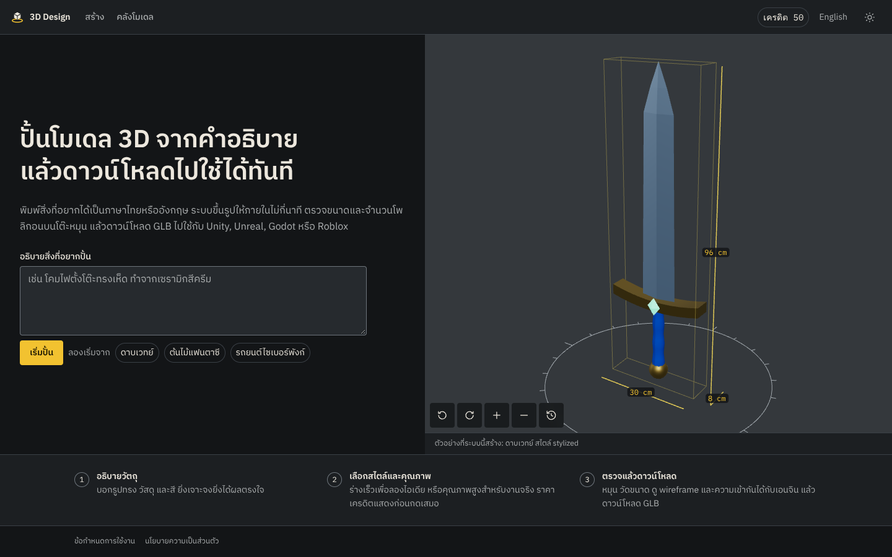
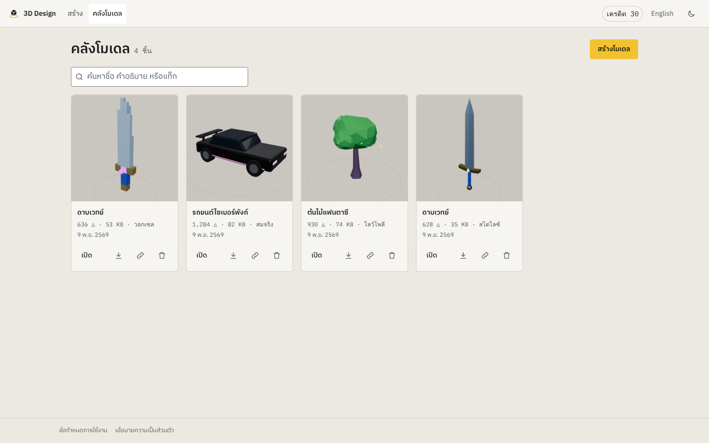
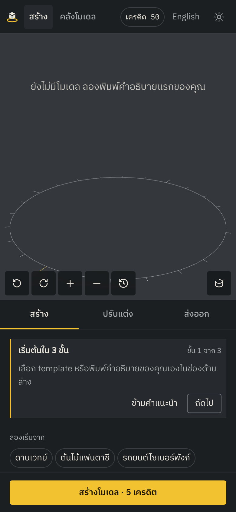
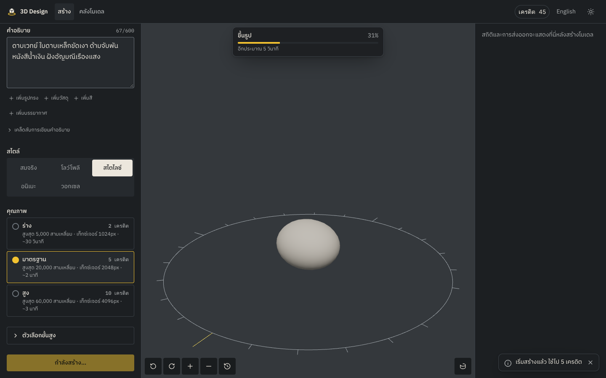
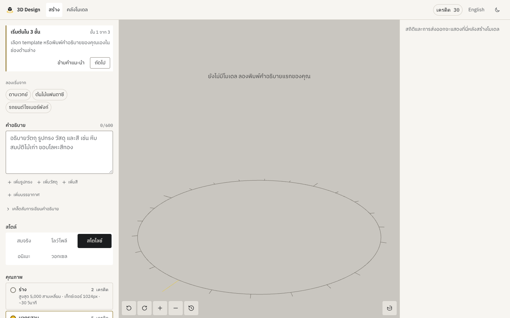
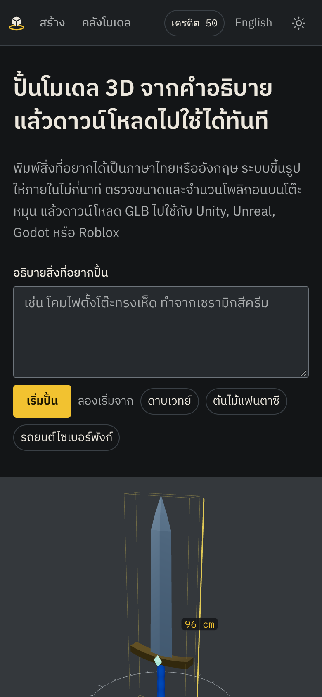
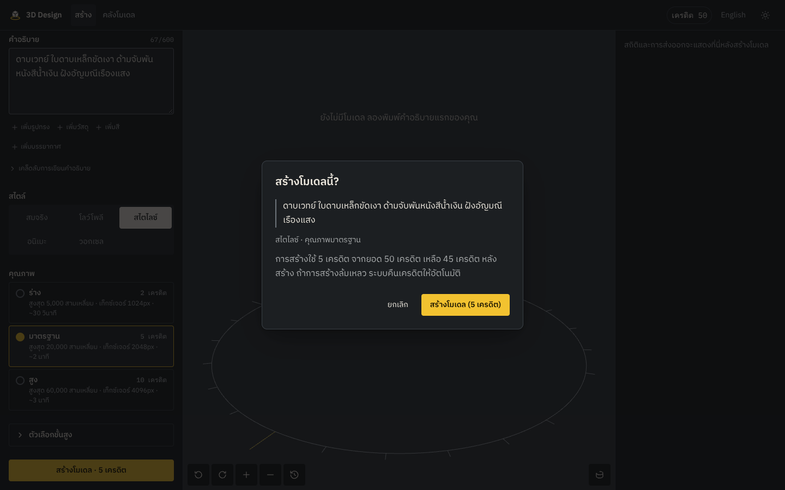
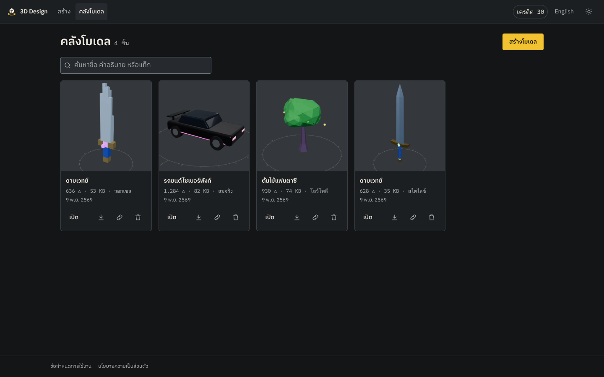

# Critique หลังสร้าง

ตรวจด้วย Playwright + Chromium (software WebGL) บน 1440×900, 820×1180 และ 390×844 ทั้งสองธีม
ภาพทั้งหมดอยู่ใน [screenshots/](screenshots/)

| เดสก์ท็อป มืด                              | เดสก์ท็อป สว่าง                                 | มือถือ                                  |
| ------------------------------------------ | ----------------------------------------------- | --------------------------------------- |
|      |       |  |
|        |  |    |
|  |        |                                         |

## สิ่งที่ตรวจและผล

| หัวข้อ         | วิธีตรวจ                                                                                             | ผล                                                                                                                  |
| -------------- | ---------------------------------------------------------------------------------------------------- | ------------------------------------------------------------------------------------------------------------------- |
| Responsive     | ภาพหน้าจอ 3 ขนาด + e2e `mobile.spec.ts` วัดตำแหน่ง viewer/แท็บ และ `scrollWidth`                     | viewer อยู่บนแท็บในจอ < 1024px, ปุ่มสร้างติดล่างจอ, ไม่มี scroll แนวนอนที่ 390px                                    |
| Keyboard focus | Tab ผ่านทุกคอนโทรล, ภาพ focus ring                                                                   | วงสีเหลือง 2px + offset ทุกองค์ประกอบ; radio/tab ใช้ลูกศร (roving tabindex); viewer รับลูกศร/+/−/0; มี skip link    |
| Dialog         | e2e: Ctrl+Enter เปิด, focus อยู่ปุ่มยืนยัน, Escape ปิดโดยไม่ตัดเครดิต; dialog ลบ focus ที่ "เก็บไว้" | ผ่าน                                                                                                                |
| Reduced motion | context `reducedMotion: 'reduce'`                                                                    | ปุ่มหมุนอัตโนมัติถูกปิด, ไม่มี damping กล้อง, ก้อนดินไม่ "หายใจ", transition/animation เหลือ 1ms                    |
| Contrast       | `pnpm --filter @3d-design/web contrast` (อ่านจาก tokens.css)                                         | ทุกคู่ผ่าน WCAG AA ทั้งสองธีม (ตารางด้านล่าง)                                                                       |
| Screen reader  | aria snapshot จาก Playwright                                                                         | ทุกปุ่มไอคอนมี label, progress มี `role=progressbar` + valuetext, toast แยก polite/alert, ยอดเครดิตเป็น live region |
| Lint a11y      | `eslint-plugin-jsx-a11y` recommended                                                                 | ผ่าน; ข้อยกเว้น 2 จุดมีคำอธิบายในโค้ด (backdrop click ของ dialog, viewer ที่เป็น keyboard widget)                   |

### Contrast

| คู่สี                            | มืด   | สว่าง | เกณฑ์        |
| -------------------------------- | ----- | ----- | ------------ |
| ตัวอักษรหลักบนพื้น               | 14.85 | 13.95 | 4.5          |
| ตัวอักษรรองบนแผง                 | 7.25  | 6.49  | 4.5          |
| ป้ายปุ่มหลัก (ดำบนเหลือง)        | 10.89 | 10.89 | 4.5          |
| ตัวเลขวัดขนาด (accent-ink บนแผง) | 9.88  | 5.74  | 4.5          |
| ข้อความ error                    | 5.36  | 6.04  | 4.5          |
| ป้าย "พร้อมใช้"                  | 8.43  | 4.61  | 4.5          |
| ขอบช่องกรอกกับพื้นช่อง           | 3.05  | 3.72  | 3 (non-text) |
| ขีดองศาโต๊ะหมุนบน viewer         | 3.95  | 3.07  | 3 (non-text) |

## ปัญหาที่เจอระหว่าง critique และแก้แล้ว

1. **สลับโมเดลไปมาไม่หยุด (บั๊กจริง)** — effect สองตัวที่ sync `?model=` กับ store แย่งกัน เมื่อมีโมเดลใหม่ URL เก่าเปิดโมเดลเก่ากลับ
   viewer โหลดสลับไปมาและภาพย่อไม่ถูกสร้าง แก้โดยให้ URL เป็นแหล่งความจริงเดียว
2. **กล่องขอบเขตหายตั้งแต่โมเดลที่สอง (บั๊กจริง)** — `useEffect` ของ parent รีเซ็ตขนาดหลัง `useLayoutEffect` ของโมเดลใหม่
   ทำให้กล้องไม่ fit, วัดขนาดและเงาไม่ขึ้น แก้โดยผูกขนาดกับ url และคำนวณตอน render เพิ่ม e2e กันถอยหลัง
3. **โฟกัสใน dialog หาย** — `autoFocus` ของ React ทำงานตอน `<dialog>` ยังปิด เปลี่ยนเป็น focus หลัง `showModal()`
4. **ตัวกรองแท็กค้าง** หลังลบโมเดลสุดท้ายของแท็กนั้น หน้า library แสดง "ไม่พบ" แทน empty state แก้ให้โหลดใหม่และล้างตัวกรอง
5. **ขอบคอนโทรล contrast ต่ำ** (2.2–2.7:1) ปรับ `--line-strong` และ `--viewer-ink` ให้ผ่าน 3:1 และใช้กับขอบช่องกรอก
6. **โลหะดูดำ** เพราะ environment light เกือบทั้งหมดเป็นสีดำ เพิ่มพื้นสีเทากลางให้ IBL ทุกชุด
7. **ป้ายสไตล์ตัดกลางคำ** ("โลว์โพ/ลี") เปลี่ยนเป็น grid 3+2 และห้ามตัดบรรทัดในป้าย
8. **ปุ่มสีเหลืองสองปุ่ม** ใน empty state ของ library ซ่อนปุ่มบนเมื่อ empty state มีปุ่มเดียวกันอยู่แล้ว
9. **ป้าย "ตัวสร้างจำลอง" ทับแถบความคืบหน้า** และหายบนมือถือ ย้ายไปไว้ใต้ปุ่มดาวน์โหลดในแผงส่งออก
10. **ชื่อโมเดลยาวทั้งประโยค** จากคำอธิบายภาษาไทย ปรับให้ใช้วลีแรก ("ดาบเวทย์ ใบดาบ…" → "ดาบเวทย์")
11. **ชื่อไฟล์ดาวน์โหลดภาษาไทย** กลายเป็น "download" ในบางเบราว์เซอร์ เปลี่ยนเป็นชื่อ ASCII + รหัสสั้น เช่น `model-7k2x9p.glb`
    (ชื่อไทยยังอยู่ในไฟล์และใน header `filename*`) ซึ่งปลอดภัยกับ asset pipeline ของเอนจินด้วย

## ข้อจำกัดที่ยังเหลือ

- ตัวสร้าง mock รู้จักวัตถุ 7 แบบ (ดาบ ต้นไม้ รถ บ้าน แจกัน คริสตัล หีบ) คำอื่นได้ "ก้อนดินปั้น" ตาม seed
  ซึ่งตั้งใจให้เป็นตัวแทนระหว่างพัฒนา ไม่ใช่ผลิตภัณฑ์
- ETA ช่วงแรกใช้ค่าประมาณจาก preset จนกว่าความคืบหน้าเกิน 10% จึงเปลี่ยนเป็นค่าที่คำนวณจากความเร็วจริง
- ภาพย่อสร้างจาก canvas ของเบราว์เซอร์ผู้ใช้ ถ้าผู้ใช้ปิดหน้าก่อนโมเดลแสดง ภาพย่อจะว่างจนกว่าจะเปิดโมเดลนั้นอีกครั้ง
- viewer chunk (three.js + drei) 300 KB gzip โหลดแบบ lazy เฉพาะหน้าที่มี viewer
