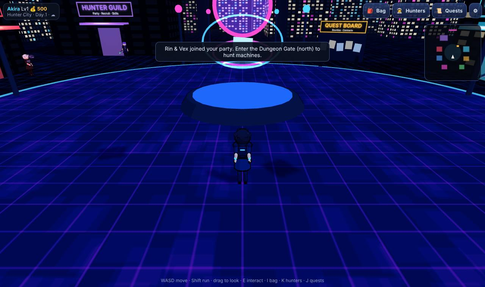
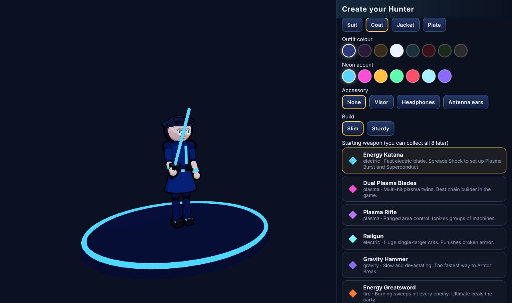
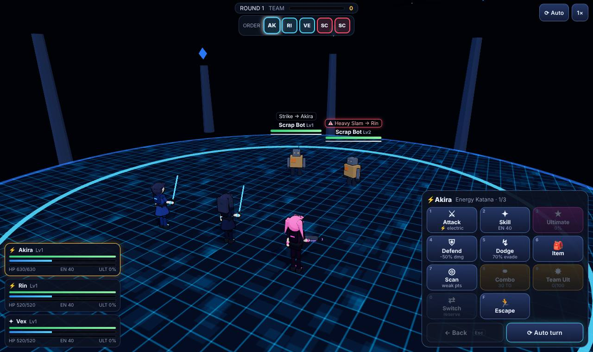
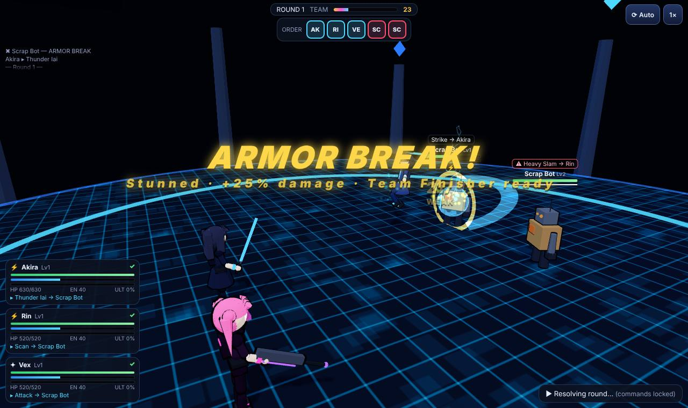
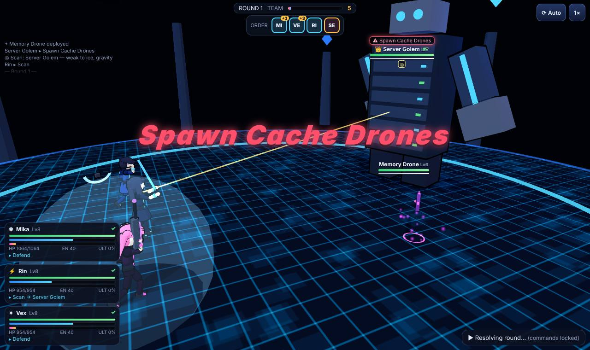
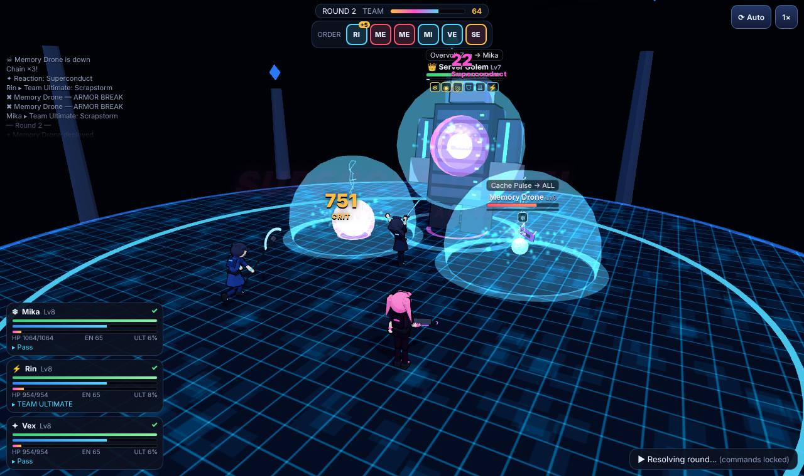
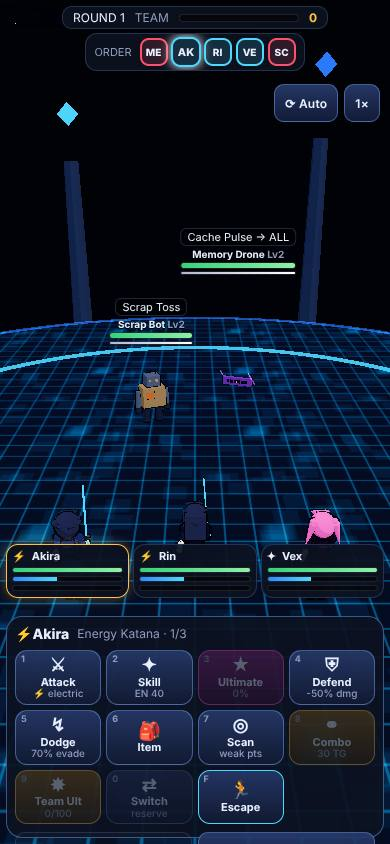
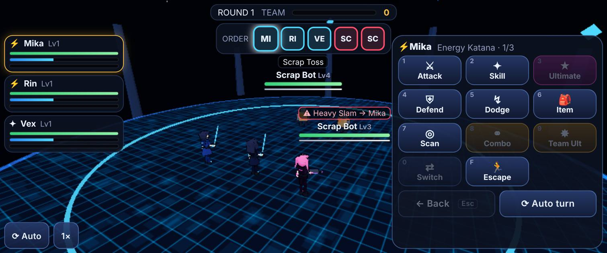
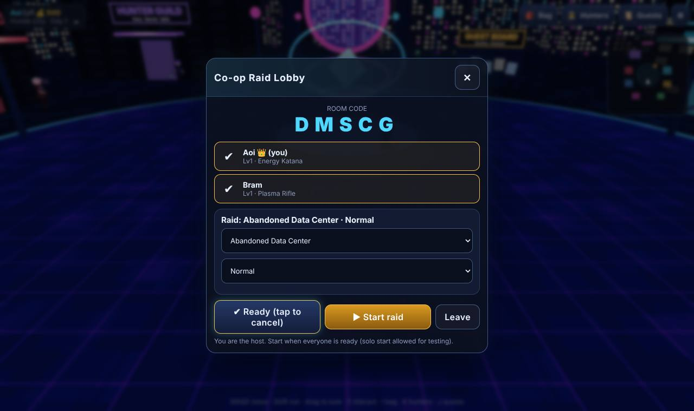
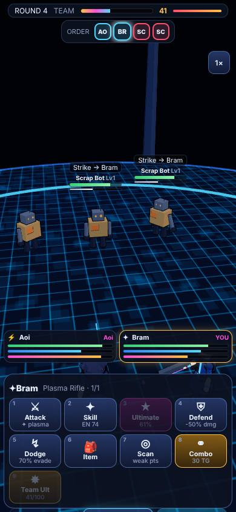

# TEST REPORT — SCRAPBOUND

วันที่ทดสอบ: 2026-11-04 · สภาพแวดล้อม: Node 22, Chromium (Playwright, headless, SwiftShader WebGL), `wrangler dev` (workerd + D1/Durable Objects แบบ local)

## สรุป

| ชุดทดสอบ | ผล |
|---|---|
| Typecheck client + server (`npm run typecheck`) | ✅ ผ่าน |
| Unit / integration (`npm test`, Vitest) | ✅ **56/56** (4 ไฟล์) |
| Production build (`npm run build`) | ✅ index 85KB + three 146KB + battle chunk 16KB + CSS 5KB (gzip) |
| Worker bundle (`wrangler deploy --dry-run`) | ✅ bindings: RaidRoom DO, D1, Assets |
| E2E desktop flow (1280×760) | ✅ 0 errors |
| E2E mobile portrait flow (390×844, touch) | ✅ 0 errors |
| E2E boss showcase + phone landscape ด้วย `tap()` จริง | ✅ 0 errors |
| E2E co-op 2 ผู้เล่น (desktop + mobile) ผ่าน Worker + Durable Object | ✅ 0 errors |
| E2E resume กลางดันเจี้ยน + กู้ cloud save | ✅ 0 errors |
| Deploy ขึ้น Cloudflare production | ⏸ ไม่ได้ทำ — session นี้ไม่มี Cloudflare account/token (CI พร้อม deploy เมื่อใส่ secret) |

## Unit tests (Vitest)

**tests/combat.test.ts (25)** — battle lifecycle (สร้าง, deterministic ตาม seed, ไม่ mutate input, auto battle จบใน 40 รอบ) · turn order (priority > speed, Defend ขึ้นก่อน, Delay/Haste) · validation (ultimate ไม่เต็ม, สกิลที่ไม่มี, team gauge, เป้าผิด, ยูนิตของคนอื่นใน co-op, คำสั่งผิด→Defend) · elements (weakness > normal, Plasma Burst + splash + ใช้สถานะ, สถานะจากการตีเดียวกันไม่ react ตัวเอง, Chill×2→Frozen→ข้ามเทิร์น, Armor Break + interrupt ท่าชาร์จ + team gauge, **chain ตามบรีฟ Electric→Shock→Plasma Burst→Break→TEAM FINISHER**, chain counter) · commands (Defend ลดดาเมจ, Scan, Item ใช้จากกระเป๋า+นับ, Switch reserve, Team Ultimate, co-op Team Ult ต้องทุกคนยอม) · bosses (Server Golem เรียกโดรน→Data Shield→โล่หายเมื่อโดรนตาย, phase threshold เปลี่ยนสกิล, Reactor meltdown, AI ใช้ท่าหลากหลาย ≥ 4 แบบ)

**tests/economy.test.ts (15)** — PC compatibility (ผ่าน, socket ไม่ตรง, RAM ผิดชนิด, PSU อ่อน, overheat, GPU PCIe/ยาวเกิน, ขาดวัสดุ, Quantum ต้อง Q-SOCKET, ของดีราคาสูงกว่า), orders, market deterministic, rarity distribution, drop table แยกต่อหุ่น, บอส drop Rare+, spec อยู่ในช่วง

**tests/world.test.ts (14)** — dungeon 5 แห่ง × 14 seeds: มี start/boss/mini-boss, เดินถึงทุกห้อง (รวม hidden), บอสถูกตัว, ≤ 4 ศัตรู/กลุ่ม · deterministic · ความยากเพิ่มเลเวล · save ใหม่ผ่าน validation · ปฏิเสธเงินปลอม/skill point เกิน/spec ปลอม/อาวุธที่ไม่มีจริง · plausibility (เงินพุ่ง 5M ใน 1 นาที = ผิด) · EXP→level+SP · skill tree prerequisite + tech skill เข้า build · inventory stack + overflow ไป storage · quest progress

**tests/balance.test.ts (2)** — จำลองการต่อสู้อัตโนมัติ (AI ทั้งสองฝั่ง) ทุกดันเจี้ยน:

```
data_center    party Lv 1 | normal 18/18 rounds 2.8 hpLeft 86% | boss Lv7 default 2/10 · tailored 3/10   ← underleveled = บอสยาก (ตั้งใจ)
data_center    party Lv 4 | normal 18/18 rounds 2.1 hpLeft 94% | boss Lv7 default 10/10 r9
cyber_factory  party Lv 5 | normal 27/27 rounds 3.3 hpLeft 94% | boss Lv12 default 10/10 r7
nuclear_core   party Lv10 | normal 30/30 rounds 3.0 hpLeft 89% | boss Lv18 default 0/10 · tailored 10/10 r10  ← ต้องใช้ธาตุที่ถูก (Ice/Quantum)
ai_lab         party Lv20 | normal 33/33 rounds 3.0 hpLeft 94% | boss Lv24 default 10/10 r15 · tailored 9/10
abyss          party Lv27 | normal 30/30 rounds 3.5 hpLeft 91% | boss Lv33 default 8/10 r45 · tailored 9/10 r26
co-op raid (กลุ่มธาตุผสม) 2P/4P ที่เลเวลกลางภูมิภาค: data_center 10/10 · cyber_factory 10/10 · nuclear_core 10/10
```

assert: ชนะการต่อสู้ปกติ ≥ 95% ที่เลเวลขั้นต่ำของภูมิภาค, บอสชนะ ≥ 8/10 เมื่อจัดทีมถูกธาตุที่เลเวลสูงสุด, บอสแรกชนะ ≤ 6/10 ถ้าเลเวล 1, co-op raid ≥ 5/10 — ผลนี้ใช้จูน `TUNING` ใน `src/core/combat/units.ts` และ HP บอส

## E2E (Playwright — เล่นเกมจริงในเบราว์เซอร์)

### `e2e/flow.mjs` — desktop และ mobile portrait
สร้างตัวละคร → เมือง (เดินด้วย W) → เข้า Abandoned Data Center → เข้าการต่อสู้ → **สั่งเองทีละคน** (Skill Thunder Iai → เลือกเป้า, Scan, Attack) → ดูแอนิเมชันระหว่างคำสั่งถูกล็อก → รอบ 2 → เปิด Auto + 3× → ชนะ → หน้ารางวัล → กลับดันเจี้ยน → ตรวจ save ใน localStorage (credits/kills/battles/wins/EXP เพิ่มขึ้นจริง)
ผล: desktop `{"kills":2,"battles":1,"wins":1}` / mobile `{"kills":2,"wins":1,"lvl":"2:0"}` — **0 console errors**

### `e2e/showcase.mjs` — บอส + มือถือแนวนอน
Server Golem: intro, telegraph "Spawn Cache Drones", Data Shield, Scan เปิดจุดอ่อน (ice, gravity), Ultimate cut-in, **Team Ultimate**, reaction **Superconduct**, **ARMOR BREAK** บนบอส · Pixel 7 landscape: ใช้ `tap()` เลือก Attack→เป้า, Skill→แตะป้ายชื่อศัตรูในฉาก 3D, Defend → เข้าสู่ "Resolving round… (commands locked)" — **0 errors**

### `e2e/coop.mjs` — 2 ผู้เล่นจริง (desktop 1280×760 + mobile 390×844) ผ่าน Worker/DO
```
room DMSCG  → join ด้วย code → ready ทั้งคู่ → host start
B sees A locked                      (แชร์แผน/สถานะ lock แบบ real-time)
round 2 states identical: true       (ทั้งสองเครื่องได้ state เดียวกันจากเซิร์ฟเวอร์)
B socket closed → A resolved round 2 while B was disconnected (AI took over)
B reconnected → after reconnect rounds A/B: 3 3
turn timer resolved idle player after 19.2s   (timer 30s นับจากเปิดรอบ)
raid end → "+32 credits +78 EXP 2 items" รับผ่าน /api/grants/claim
errors: []
```
(raid ในเทสต์นี้แพ้เพราะเป็นตัวละคร Lv1 สองคน — ครอบคลุม defeat path; ฝั่งชนะครอบคลุมโดย balance simulation ของ raid)

### `e2e/resume.mjs`
ปิดแท็บระหว่างอยู่ในดันเจี้ยน → เปิดใหม่ → ปุ่ม "Continue — Sora Lv1 (in dungeon)" → กลับเข้า Abandoned Data Center ตำแหน่งเดิม · ลบ save ในเครื่อง (เก็บ session ไว้) → เปิดใหม่ → ดึง cloud save กลับมา `{"name":"Sora","credits":777}` — **0 errors**

### REST / anti-cheat (curl กับ `wrangler dev`)
guest → token, `/api/me` ✅ · `PUT /api/save` ข้อมูลปลอม → `422 {"error":"Save rejected","details":["name","hunters","inventory size","party"]}` ✅ · static assets `/` → 200 ✅

## ภาพหน้าจอ (docs/screenshots)
| | |
|---|---|
|  Hunter City |  Character creator |
|  Battle planning (desktop) |  Skill animation (input locked) |
|  Boss telegraph + Scan |  Team Ultimate + Superconduct |
|  Mobile portrait |  Mobile landscape |
|  Co-op lobby |  Co-op (มือถือ) |

## ปัญหาที่พบระหว่างทดสอบและแก้แล้ว
- ผมของตัวละครบังหน้า (hair cap เป็นทรงกลมเต็ม) → เปลี่ยนเป็นครึ่งบน + ผมด้านหลัง
- ป้ายชื่อศัตรูซ้อนกันบนจอแคบ → อัลกอริทึมเลี่ยงการซ้อน (ขึ้นบน/ลงล่าง, ไม่ทับแถบด้านบน)
- มือถือแนวนอน: ปุ่ม Auto ทับ timeline และ footer คำสั่งถูกตัด → layout landscape เฉพาะ
- ศัตรูทั่วไปง่ายเกิน / บอสบางตัวชนะไม่ได้ → จูนด้วย balance simulation
- co-op 2 คนยากเกิน → ปรับ party scale + เลเวลบอส raid ตามเลเวลปาร์ตี้ + แสดงเลเวลแนะนำ
- เปิดเครื่องใหม่ที่ไม่มี save ในเครื่องไม่ดึง cloud save → แก้ boot sync
- Three r187 deprecations (`Clock`, `PCFSoftShadowMap`) → ใช้ `Timer`, `PCFShadowMap`

## ข้อจำกัดของการทดสอบ
- ทดสอบบน headless Chromium + SwiftShader (software GPU) — FPS จริงบนอุปกรณ์ยังไม่ได้วัด; มี FPS monitor + auto-downgrade ในเกม
- ยังไม่ได้ทดสอบบน Safari iOS / อุปกรณ์จริง
- ยังไม่ได้ deploy production จึงยังไม่มี URL สาธารณะ
