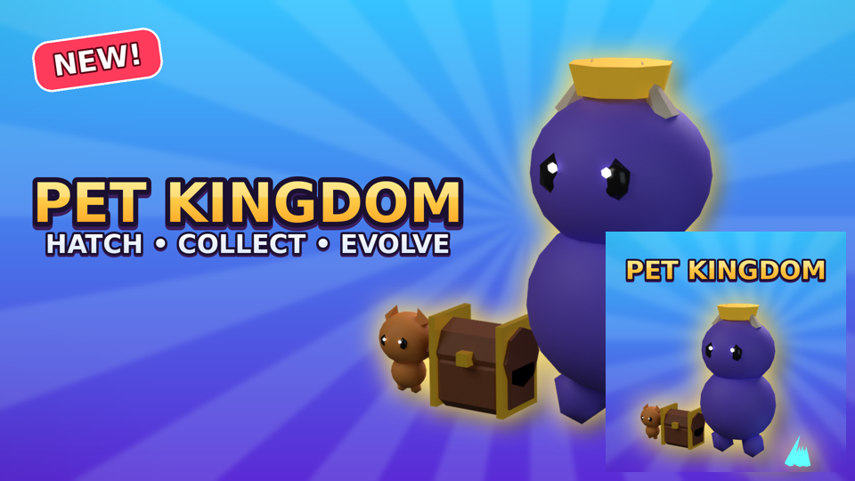

# 🎮 Roblox Game Studio — ทีม AI สร้างแมพ Roblox ทุกแนว

## ทีม (`.claude/agents/`)
| ตำแหน่ง | Agent | หน้าที่ |
|---|---|---|
| ผู้กำกับ/ไอเดียหลัก + โปรดิวเซอร์ | `rbx-director` | คิดคอนเซ็ปต์, เขียน GDD, วางแผน PLAN.md, คุมด่าน (gate) และสั่งงานทีม |
| นักออกแบบเศรษฐกิจ/เกมพาส | `rbx-economy` | ราคา, เกมพาส (โรบัคจริง), Dev Products, รางวัลรายวัน, เควส, แผนอัปเดต |
| หลังบ้าน/เขียนโค้ด | `rbx-engineer` | Luau ฝั่งเซิร์ฟเวอร์/ไคลเอนต์, ระบบเซฟ, เกมพาส, ระบบตามแนวเกม |
| ออกแบบแมพ/ฉาก | `rbx-world-builder` | เลย์เอาต์โซน, แสง/บรรยากาศ, สร้างแมพแบบไม่แลค |
| โมเดล/ตัวละคร/เอฟเฟค | `rbx-3d-artist` | Blender: พร็อพ, ตัวละคร/สัตว์เลี้ยง/บอส (มี rig), VFX, เรนเดอร์ |
| UI/UX + ปกเกม | `rbx-ui-designer` | HUD, ร้านค้า, เมนู, ไอคอน, ปก 1920×1080 + ไอคอนเกม 512 |
| QA/ประสิทธิภาพ/ความปลอดภัย | `rbx-qa` | ตรวจโค้ด, กันโกง, กันแลค, เช็คลิสต์ก่อนเปิดเกม |

## ขั้นตอน (วางแผนก่อนลงมือ)
1. **Design** → GDD 1 หน้า + PLAN.md → *คุณอนุมัติ (G1)*
2. **Scaffold** → `roblox/tools/new_game.sh <slug> "<ชื่อเกม>" <preset>`
3. **Build** (ทำพร้อมกัน) → โค้ด / แมพ / โมเดล / UI+ปก
4. **Integrate** → ใส่ asset id, เล่นได้ครบลูป
5. **QA** → `roblox/tools/check.sh roblox/games/<slug> --release`
6. **Launch** → สร้างเกมพาสบน Creator Hub, อัปโหลดปก, แผนอัปเดต 4 สัปดาห์

แค่พิมพ์: *"สร้างแมพ roblox แนว simulator เลี้ยงสัตว์"* → ใช้สกิล `rbx-build-game` อัตโนมัติ

## สิ่งที่เทมเพลตมีให้แล้ว (เล่นได้ทันที)
- เซฟข้อมูลแบบ session-lock + retry + autosave (เล่นใน Studio ได้แม้ไม่เปิด API)
- เงิน Coins/Gems + leaderstats, **เกมพาส** (ตรวจสิทธิ์ฝั่งเซิร์ฟเวอร์, perk: x2 เงิน, วิ่งเร็ว, เทรล, แท็ก VIP), **Dev Products** (ProcessReceipt กันได้ของซ้ำ)
- รางวัลรายวัน 7 วัน, รางวัลเวลาเล่น, เควสรายวัน, ลีดเดอร์บอร์ดโลก, Analytics + Badge
- แสงสำเร็จรูป 4 แบบ, แมพเริ่มต้น, เหรียญเดโม (ลูปเกมพื้นฐาน)
- UI วาดด้วยโค้ด: HUD, ร้านค้า, รางวัล, เควส, ตั้งค่า (โหมดกราฟิกต่ำ), toast, รองรับมือถือ
- ในโหมด Studio ทดลองซื้อเกมพาสที่ยังไม่ใส่ id ได้ (id = 0)

## เครื่องมือ (ไม่กินโทเคน)
```bash
roblox/tools/setup_tools.sh                       # ติดตั้ง luau + luau-lsp สำหรับ check.sh (ครั้งเดียว)
# Blender (หรือ pip install bpy ใน Python 3.11)
blender -b -P roblox/tools/blender/make_asset.py -- --type all --out art/blender/
blender -b -P roblox/tools/blender/make_character.py -- --style pet --color "#ff9f43" --out art/blender/pet.fbx
blender -b -P roblox/tools/blender/make_vfx_mesh.py -- --type all --out art/blender/vfx/
blender -b -P roblox/tools/blender/render_shot.py -- --in art/blender/pet.fbx --out art/renders/hero.png
# 2D (Pillow)
python3 roblox/tools/art/make_icons.py --out art/icons --sheet
python3 roblox/tools/art/make_vfx.py --out art/vfx
python3 roblox/tools/art/make_thumbnail.py --title "ชื่อเกม" --hero art/renders/hero.png --badge "NEW!" --out art/store
```

## เปิดใน Roblox Studio
ติดตั้ง [Rojo](https://rojo.space) → `cd roblox/games/<slug> && rojo serve` → Studio: ปลั๊กอิน Rojo → Connect → Play
(Game Settings → Security → เปิด *Enable Studio Access to API Services* เพื่อทดสอบเซฟ)

ก่อนเปิดเกมจริง: สร้าง Passes/Developer Products ใน Creator Hub แล้วใส่ id ใน `src/shared/Config/GamePasses.luau` / `Products.luau`

## ตัวอย่างผลลัพธ์จากเครื่องมือ (สร้างจริงด้วยสคริปต์ในโฟลเดอร์นี้)



